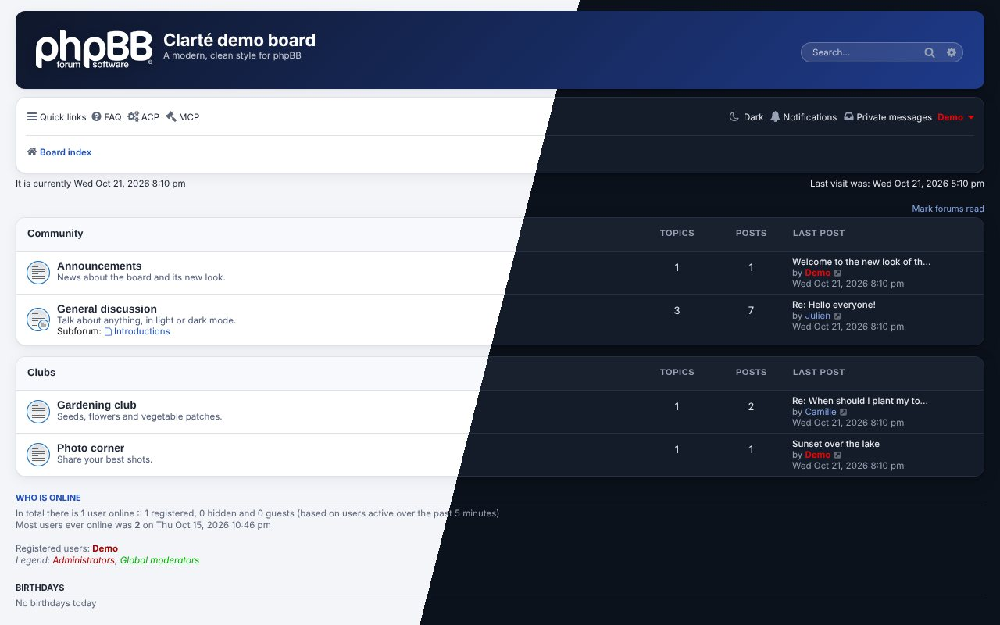
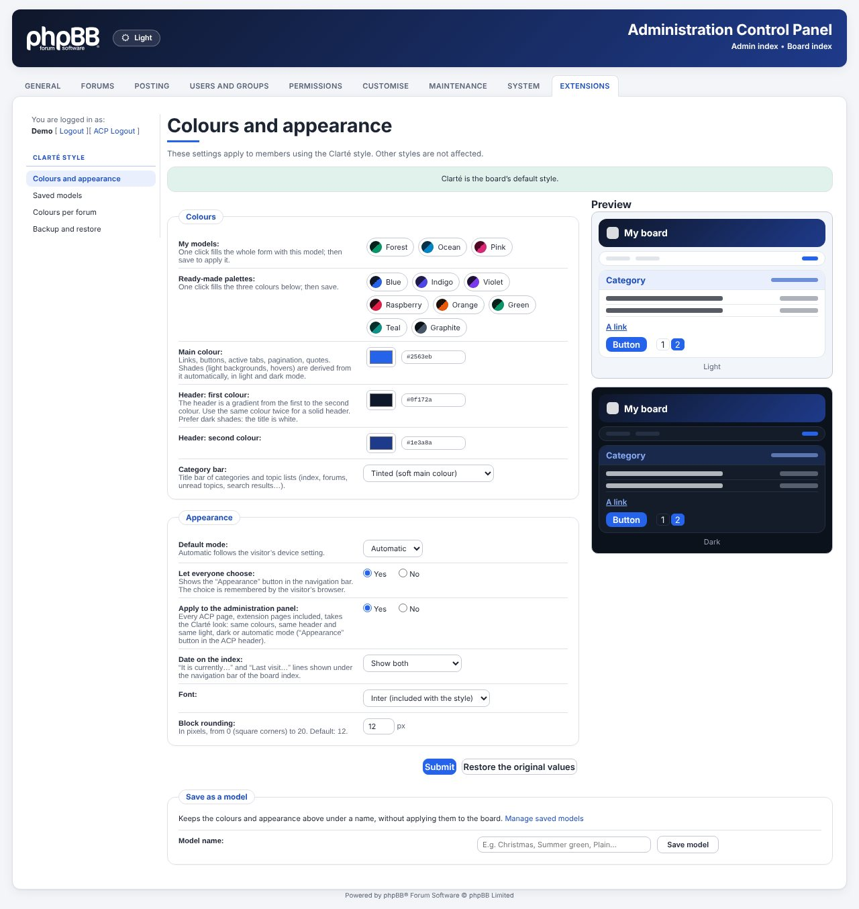
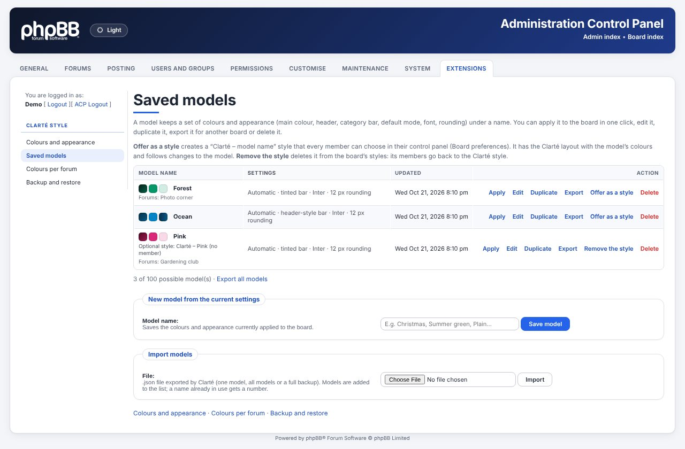
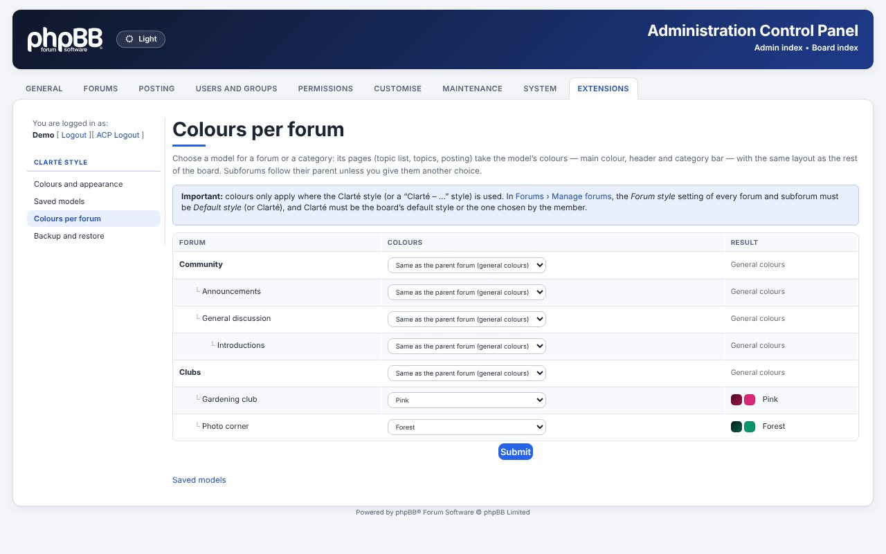
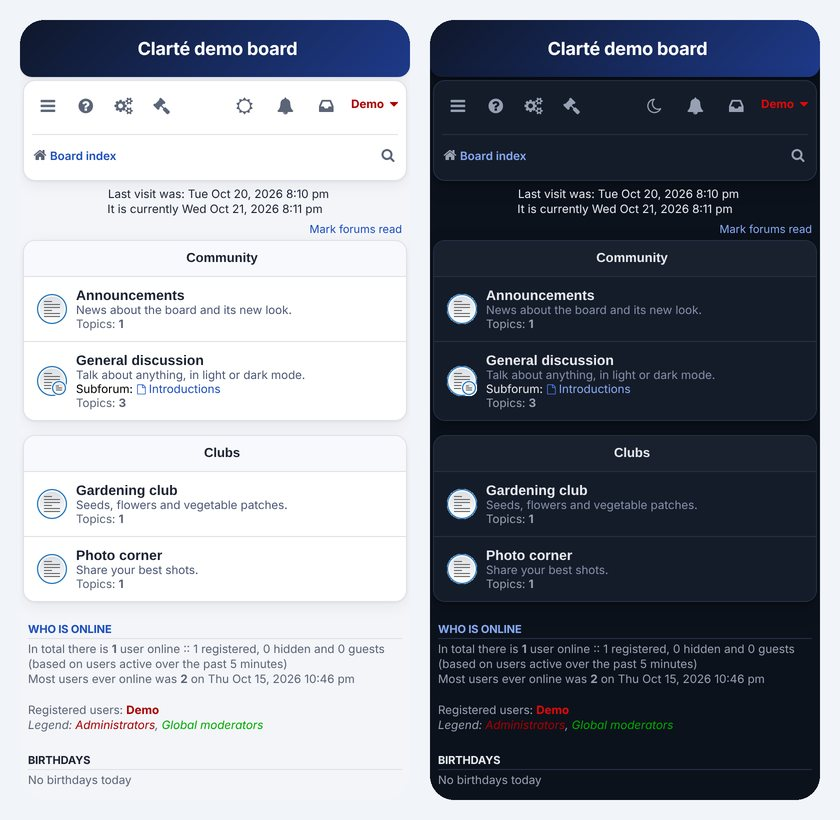

# Clarté — phpBB style

   

🇫🇷 **[Version française](README.md)**

A complete, modern style for phpBB 3.3.15 and later: gradient header, rounded blocks, the Inter font, **light, dark or automatic mode**, and a **main colour set in the ACP**. **The whole administration panel (ACP) gets the same look**, extension pages included. Colour **models** can be saved under a name, applied **forum by forum**, or turned into **optional styles** members can choose. It is designed to go with the [Portfolio](https://github.com/verturin/portfolio) extension, which automatically follows its colours and mode, on the board and in the ACP.

## Features

- **Light, dark or automatic mode** on the whole board, with an *Appearance* button in the navigation bar (remembered by the browser, guests included), with no flash on load.
- **Colours set in the ACP**: ready-made palettes or free colours, main colour, gradient header, category bar, font, block rounding, live light / dark preview.
- **Saved models**: keep a set of colours under a name, apply, edit, duplicate, export or import it (.json).
- **Colours per forum**: a model for a forum or a category, inherited by its subforums.
- **Optional styles**: a model becomes a “Clarté – name” style that members pick in their control panel; removed in one click, its members go back to Clarté.
- **Backup and restore** of every setting, model, forum colour and optional style.
- **The whole ACP with the Clarté look**, extension pages included (can be switched off).
- **Mobile**: compact navigation bar with icons only; the index date lines can be hidden; group colours stay readable in dark mode.
- No new table, no phpBB file edited; languages: English, French.

| Colours and appearance | Saved models |
|---|---|
|  |  |
| **Colours per forum** | **Mobile, icons-only navigation bar** |
|  |  |

## Download

Each release ([Releases](https://github.com/verturin/clarte/releases) tab) offers three packages:

| Package | Content | Use |
|---|---|---|
| `clarte - v X.Y.Z.zip` | `styles/clarte/` + `ext/verturin/clarte/` | **recommended**: all of Clarté, to upload to the board root |
| `clarte-style - v X.Y.Z.zip` | `clarte/` | the style only (upload into `styles/`) |
| `clarte-extension - v X.Y.Z.zip` | `verturin/clarte/` | the extension only (upload into `ext/`) |

The style works on its own (blue, automatic mode); the extension adds every setting described here.

## Installation

1. Unzip `clarte - v 1.4.1.zip` and upload the `styles` and `ext` folders to the board root (where `index.php` and `config.php` are). They merge with the existing folders.
2. ACP › **Customise** › **Manage extensions**: enable **Clarté — style settings**.
3. ACP › **Customise** › **Styles** › *Install styles*: install **Clarté**.
4. To use it on the whole board: ACP › **General** › *Board settings* › **Default style** = Clarté. Also check that each forum's *Forum style* (ACP › Forums › Manage forums) is set to *Default style*.
5. ACP › **Extensions** › **Clarté style** › *Colours and appearance*: choose your colours.

prosilver must stay installed: Clarté is a child style of prosilver, so phpBB fixes to prosilver also benefit Clarté.

## Update

Upload the `styles` and `ext` folders of the new package over the old ones, then in ACP › Customise › Manage extensions, disable and enable **Clarté — style settings** again (new options are added, your colours and models are kept). Finally purge the cache from the ACP index. The changelog (in the [French README](README.md#historique-des-versions)) says when disabling is not needed.

## Settings

- **Colours and appearance**: palettes, *My models*, main colour (links, buttons, tabs, pagination, quotes — every shade is derived from it), header gradient, category bar (neutral, tinted, same as the header or a chosen colour with automatic text contrast), default mode, *Let everyone choose* (Appearance button), *Apply to the administration panel*, *Date on the index*, font (Inter or device font), block rounding (0–20 px), live preview, *Save as a model*.
- **Saved models**: apply, edit, duplicate, export, import, delete, *Offer as a style* / *Remove the style*. A model holds the main colour, header, category bar, default mode, font and rounding; board options (Appearance button, ACP skin, index date) are not part of models.
- **Colours per forum**: a model, *Same as the parent forum* (default) or *General colours* for every forum and category. Only colours change (main colour, header, category bar). Forum colours win over the member's optional style. **Important**: colours only apply where Clarté (or a “Clarté – …” style) is used — each forum's *Forum style* must be *Default style* or Clarté; forums forcing another style are flagged on the page.
- **Backup and restore**: one `.json` file with every setting, model, forum colour and optional style; restore settings and/or models (added or replaced).

## Technical notes

- Every prosilver colour is turned into a CSS variable (`tools/tokenize_colours.py`) with a light and a dark value, so dark mode covers the whole board.
- The mode is applied in the page head, before drawing: no white flash.
- Colours are checked (`#rrggbb` only) before being written to the page; uploaded files are checked (format, size, values).
- Settings only apply to members using Clarté or a child style of Clarté; other styles are untouched.
- ACP: colours of phpBB's `adm/style/admin.css` (and Portfolio's ACP sheet) are converted by `tools/tokenize_admin.py` into `clarte_admin_colours.css`; `clarte_admin.css` adds the design. Both are loaded after phpBB's and extensions' sheets through `acp_overall_header_stylesheets_after`: no phpBB file is edited.
- Optional styles are real phpBB child styles (`styles/clarte_m<n>/`, a few relay files); their colours are read from the model on each page. Writing them needs write access to `styles/`.
- No table added: `clarte_*` config keys, and models / forum colours / optional styles as JSON in `config_text`.

## Uninstall

Choose another default style, uninstall Clarté in *Styles*, then disable the extension and delete its data (optional styles are removed and their members go back to the default style). Finally delete `styles/clarte` and `ext/verturin/clarte`.

## Credits

- **Inter** font © The Inter Project Authors, SIL Open Font License 1.1 (`styles/clarte/theme/fonts/OFL.txt`).
- Layout based on **prosilver** © phpBB Limited.
- Clarté © 2026 verturin — GPL-2.0.

## Recent changes

- **1.4.1** — *Colours per forum* page: reminder that Clarté must be every forum's style, forums forcing another style are flagged.
- **1.4.0** — Colours per forum (with inheritance), models offered as optional styles, backup of forum colours and optional styles, clean uninstall.
- **1.3.2** — Mobile: icons-only navigation bar.
- **1.3.1** — *Date on the index* fix when another extension moves those lines.
- **1.3.0** — Saved models, backup and restore, *Date on the index* option.

Full changelog: [French README](README.md#historique-des-versions).
