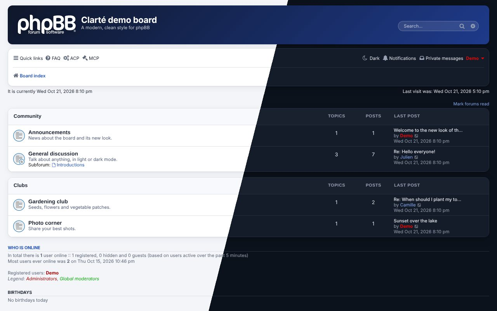
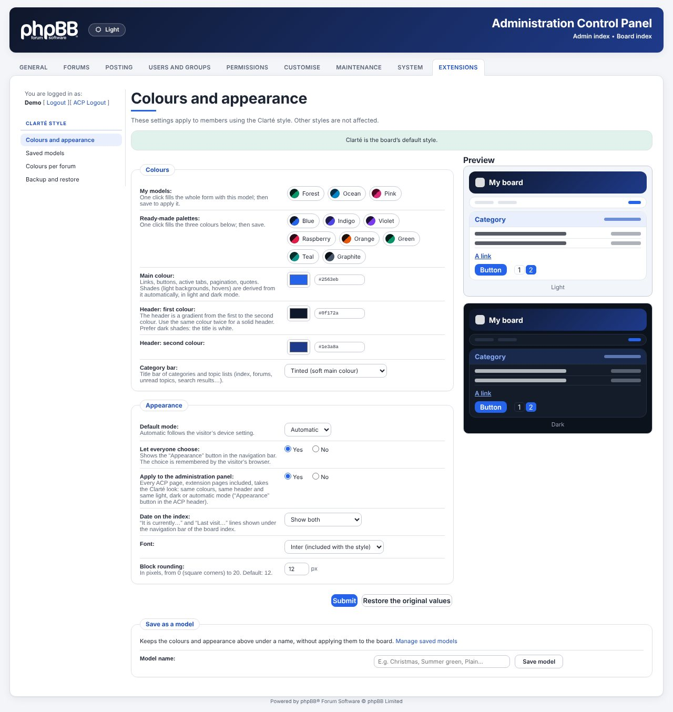
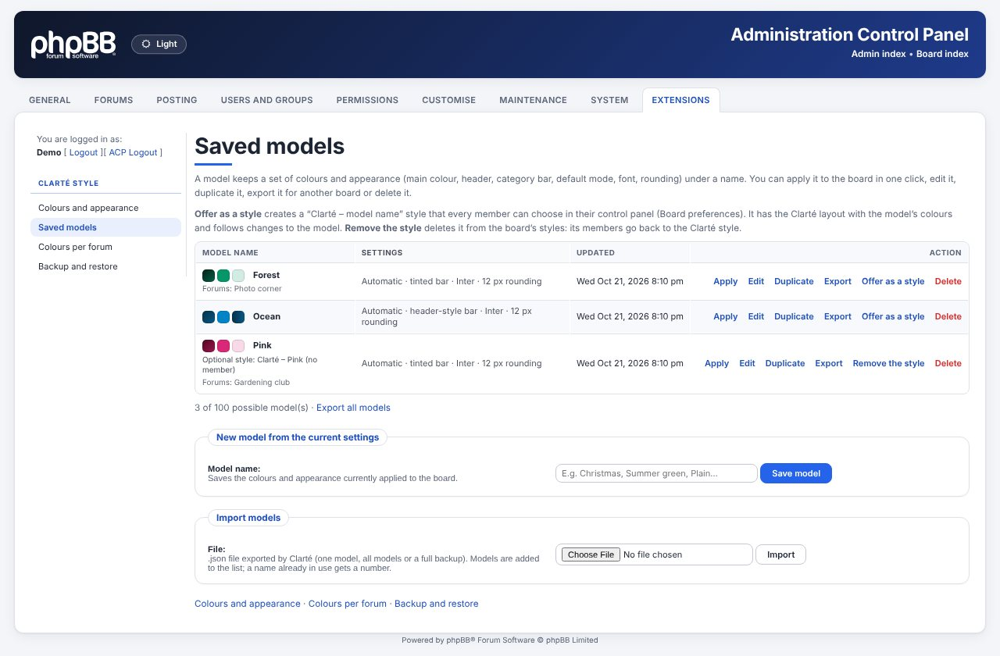
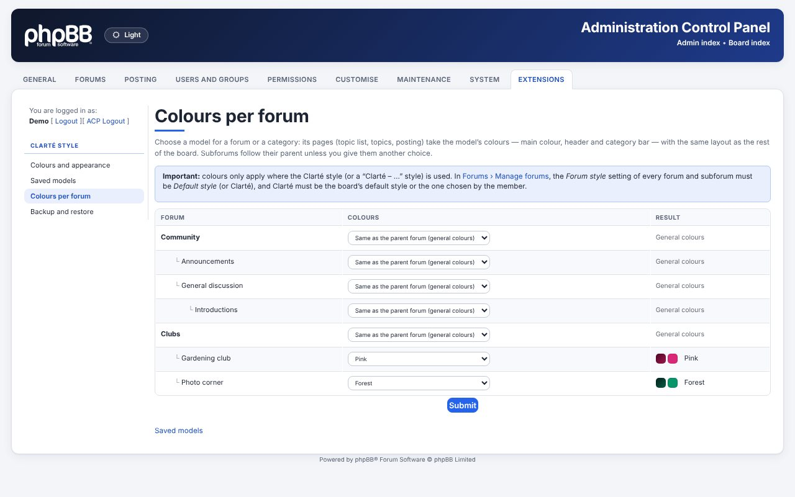
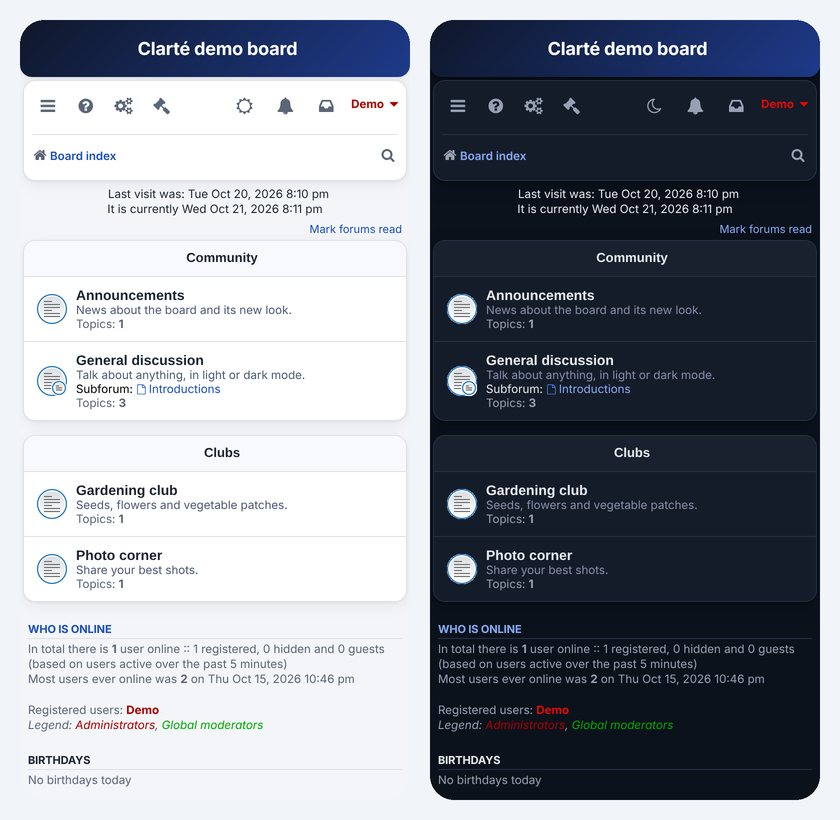
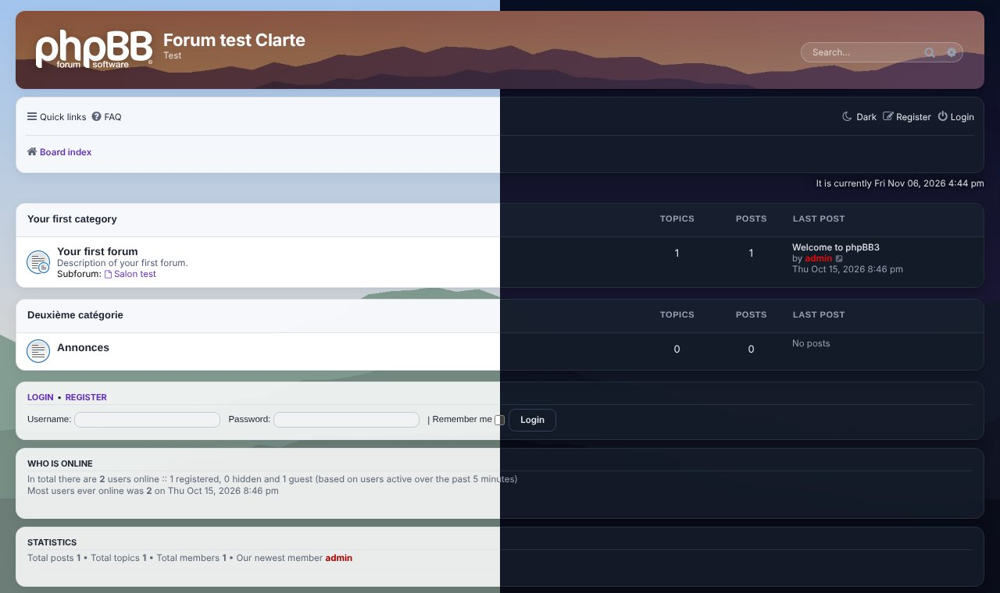

# Clarté — phpBB style

   

🇫🇷 **[Version française](README.md)**

A complete, modern style for phpBB 3.3.15 and later: gradient header, rounded blocks, the Inter font, **light, dark or automatic mode**, and a **main colour set in the ACP**. **The whole administration panel (ACP) gets the same look**, extension pages included. Colour **models** can be saved under a name, applied **forum by forum**, or turned into **optional styles** members can choose. It is designed to go with the [Portfolio](https://github.com/verturin/portfolio) extension, which automatically follows its colours and mode, on the board and in the ACP.

## Features

- **Light, dark or automatic mode** on the whole board, with an *Appearance* button in the navigation bar (remembered by the browser, guests included), with no flash on load.
- **Colours set in the ACP**: ready-made palettes or free colours, main colour, gradient header, category bar, font, block rounding, live light / dark preview.
- **Saved models**: keep a set of colours under a name, apply, edit, duplicate, export or import it (.json).
- **Colours per forum**: a model for a forum or a category, inherited by its subforums.
- **Optional styles**: a model becomes a “Clarté – name” style that members pick in their control panel; removed in one click, its members go back to Clarté.
- **Backup and restore** of every setting, model, forum colour and optional style.
- **The whole ACP with the Clarté look**, extension pages included (can be switched off), with the **pages of the current extension as tabs** above the title, always visible.
- **Text size** for the whole board, and per member in the UCP when allowed in the ACP.
- **Site icon** (favicon) uploaded from the ACP, with a dark-mode version and a home screen icon for phones.
- **Background images**: one behind the page and one in the header, each with a dark-mode version; veil, blur, translucent blocks, fixed or scrolling image, repeated pattern, mobile setting, and members can hide them.
- **Mobile**: compact navigation bar with icons only; the index date lines can be hidden; group colours stay readable in dark mode.
- No new table, no phpBB file edited; languages: English, French.

| Colours and appearance | Saved models |
|---|---|
|  |  |
| **Colours per forum** | **Mobile, icons-only navigation bar** |
|  |  |

## Download

Each release ([Releases](https://github.com/verturin/clarte/releases) tab) offers three packages:

| Package | Content | Use |
|---|---|---|
| `clarte - v X.Y.Z.zip` | `styles/clarte/` + `ext/verturin/clarte/` | **recommended**: all of Clarté, to upload to the board root |
| `clarte-style - v X.Y.Z.zip` | `clarte/` | the style only (upload into `styles/`) |
| `clarte-extension - v X.Y.Z.zip` | `verturin/clarte/` | the extension only (upload into `ext/`) |

### Together or separately

The style and the extension can be used together or separately:

| Installed | What you get |
|---|---|
| **Style + extension** (recommended) | everything described here |
| **Style alone** | the complete look, light or dark mode following the visitor's device, blue main colour; no ACP settings and no *Appearance* button |
| **Extension alone** (with prosilver or any other style) | the ACP with the Clarté look (light / dark mode, *Appearance* button, main colour from the settings), tabs for extension pages in the ACP, and the site icon (favicon) on every style; the board-side settings (colours, models, colours per forum, background images, text size…) only apply where the Clarté style is used, other styles are never touched |

## Installation

1. Unzip `clarte - v 1.8.3.zip` and upload the `styles` and `ext` folders to the board root (where `index.php` and `config.php` are). They merge with the existing folders.
2. ACP › **Customise** › **Manage extensions**: enable **Clarté — style settings**.
3. ACP › **Customise** › **Styles** › *Install styles*: install **Clarté**.
4. To use it on the whole board: ACP › **General** › *Board settings* › **Default style** = Clarté. Also check that each forum's *Forum style* (ACP › Forums › Manage forums) is set to *Default style*.
5. ACP › **Extensions** › **Clarté style** › *Colours and appearance*: choose your colours.

prosilver must stay installed: Clarté is a child style of prosilver, so phpBB fixes to prosilver also benefit Clarté.

## Update

Upload the `styles` and `ext` folders of the new package over the old ones, then in ACP › Customise › Manage extensions, disable and enable **Clarté — style settings** again (new options are added, your colours and models are kept). Finally purge the cache from the ACP index. The changelog (in the [French README](README.md#historique-des-versions)) says when disabling is not needed.

## Settings

- **Colours and appearance**: palettes, *My models*, main colour (links, buttons, tabs, pagination, quotes — every shade is derived from it), header gradient, category bar (neutral, tinted, same as the header or a chosen colour with automatic text contrast), default mode, *Let everyone choose* (Appearance button), *Apply to the administration panel*, *Date on the index*, font (Inter or device font), block rounding (0–20 px), live preview, *Save as a model*.
- **Background images**: page background and header, picked from the library or uploaded (JPG, PNG, WebP, GIF, 3 MiB and 8000 px max), optional dark-mode image, display (cover, pattern, centred), part kept, fixed or scrolling, veil 0–80%, blur 0–20 px, translucent blocks 0–60%, image on mobile or not, header veil 0–90%, *Let each member hide the images*. The **image library** shows where each image is used and deletes unused ones.
- **Saved models**: apply, edit, duplicate, export, import, delete, *Offer as a style* / *Remove the style*. A model holds the main colour, header, category bar, default mode, font and rounding; board options (Appearance button, ACP skin, index date) are not part of models.
- **Colours per forum**: a model, *Same as the parent forum* (default) or *General colours* for every forum and category. Only colours change (main colour, header, category bar). Forum colours win over the member's optional style. **Important**: colours only apply where Clarté (or a “Clarté – …” style) is used — each forum's *Forum style* must be *Default style* or Clarté; forums forcing another style are flagged on the page.
- **Backup and restore**: one `.json` file with every setting, model, forum colour and optional style; restore settings and/or models (added or replaced).

## Technical notes

- Every prosilver colour is turned into a CSS variable (`tools/tokenize_colours.py`) with a light and a dark value, so dark mode covers the whole board.
- The mode is applied in the page head, before drawing: no white flash.
- Colours are checked (`#rrggbb` only) before being written to the page; uploaded files are checked (format, size, values).
- Settings only apply to members using Clarté or a child style of Clarté; other styles are untouched.
- ACP: colours of phpBB's `adm/style/admin.css` (and Portfolio's ACP sheet) are converted by `tools/tokenize_admin.py` into `clarte_admin_colours.css`; `clarte_admin.css` adds the design. Both are loaded after phpBB's and extensions' sheets through `acp_overall_header_stylesheets_after`: no phpBB file is edited.
- Optional styles are real phpBB child styles (`styles/clarte_m<n>/`, a few relay files); their colours are read from the model on each page. Writing them needs write access to `styles/`.
- No table added: `clarte_*` config keys, two columns in the users table (`user_clarte_text`, `user_clarte_bg`), background images in `images/clarte/`, and models / forum colours / optional styles as JSON in `config_text`.

## Uninstall

Choose another default style, uninstall Clarté in *Styles*, then disable the extension and delete its data (optional styles are removed and their members go back to the default style). Finally delete `styles/clarte` and `ext/verturin/clarte`.

## Credits

- **Inter** font © The Inter Project Authors, SIL Open Font License 1.1 (`styles/clarte/theme/fonts/OFL.txt`).
- Layout based on **prosilver** © phpBB Limited.
- Clarté © 2026 verturin — GPL-2.0.

## Recent changes

- **1.8.3** — User control panel on desktop: the left menu and the friends list stay at the top of the screen while scrolling a long page, so there is no need to scroll back up to change pages. If they are taller than the screen, they scroll inside their column. Nothing changes on tablets and phones. Update from 1.8.x: upload `styles` and `ext`, then purge the cache.
- **1.8.2** — User control panel menu on tablets and phones (900 px and below): instead of a big block of stacked bars, the entries are shown as small buttons on several lines inside a frame, with a vertical line between groups and the current page highlighted. Nothing changes on desktop. Update from 1.8.x: upload `styles` and `ext`, then purge the cache.
- **1.8.1** — ACP extension tabs: placed above the title over the extension pages only (no longer over the left menu), extensions only, pages only (no extension name), small framed labels grouped in an overall frame, on several lines when there are many pages, still sticky while scrolling. Update from 1.8.0: upload `styles` and `ext`, then purge the cache.
- **1.8.0** — **Tabs for the extension pages** in the ACP: when configuring an extension with several pages, its pages are shown as tabs above the title (pages only, no extension name; extensions only, not phpBB pages), on several lines if needed, and stay visible while scrolling; new option, on by default. Update: disable and enable the extension again, then purge the cache.
- **1.7.0** — **Site icon**: favicon (.ico or square PNG), optional icon for dark mode, home screen icon (180 × 180 px PNG); applies to the whole board whatever the style, and to the ACP. Update: disable and enable the extension again, then purge the cache.
- **1.6.1** — ACP *Background images*: image lists and upload fields no longer overflow; English `composer.json`, `license.txt` added to the style (phpBB.com submission). Update from 1.6.0: upload `styles` and `ext`, then purge the cache.
- **1.6.0** — **Background images** for the page and the header (optional dark-mode images, veil, blur, translucent blocks, fixed or scrolling, pattern, mobile setting), image library, members may hide them, images included in models, model exports and backups. Update: disable and enable the extension again, then purge the cache; the server must be able to create `images/clarte/`.
- **1.5.1** — *Text size* is now a slider from 80 to 150%, in steps of 1, in the ACP and in the user control panel (with a “Board size” checkbox and a live preview). 1.5.0 sizes are converted (small 90, normal 100, large 110, extra large 125). Update: disable and enable the extension again, then purge the cache.
- **1.5.0** — *Text size* (small, normal, large, extra large) for the whole board, and *Let each member choose their size*: a “Text size” choice in the user control panel, stored in the member's profile. Update: disable and enable the extension again (new `user_clarte_text` column), then purge the cache.
- **1.4.3** — Fix for boards that also offer another style: depending on which style was shown first after a cache purge, the other style's pages failed or Clarté lost its colours, light/dark mode and Appearance button. Template events now live in `styles/all/` and only output with Clarté. When updating, **delete the old `ext/verturin/clarte/styles/clarte/` folder**, then purge the cache.
- **1.4.2** — Passes phpBB's Extension Pre-Validator (EPV) with no issue: `license.txt` in the extension folder, `utf8_htmlspecialchars()`, .json downloads sent through phpBB's response object. No visible change, no migration.
- **1.4.1** — *Colours per forum* page: reminder that Clarté must be every forum's style, forums forcing another style are flagged.
- **1.4.0** — Colours per forum (with inheritance), models offered as optional styles, backup of forum colours and optional styles, clean uninstall.
- **1.3.2** — Mobile: icons-only navigation bar.
- **1.3.1** — *Date on the index* fix when another extension moves those lines.
- **1.3.0** — Saved models, backup and restore, *Date on the index* option.

Full changelog: [French README](README.md#historique-des-versions).
