# Clarté — style phpBB

   

🇬🇧 **[English version](README.en.md)**

Style complet pour phpBB 3.3.15 et plus, au dessin moderne : en-tête en dégradé, blocs arrondis, police Inter, **mode clair, sombre ou automatique**, et **couleur principale réglable dans l'ACP**. **Toute l'administration (ACP) prend la même présentation**, pages des extensions comprises. Des **modèles** de couleurs s'enregistrent sous un nom, s'appliquent **forum par forum** ou deviennent des **styles au choix** des membres. Il est fait pour aller avec l'extension [Portfolio](https://github.com/verturin/portfolio), qui prend automatiquement ses couleurs et son mode, sur le forum comme dans l'ACP.

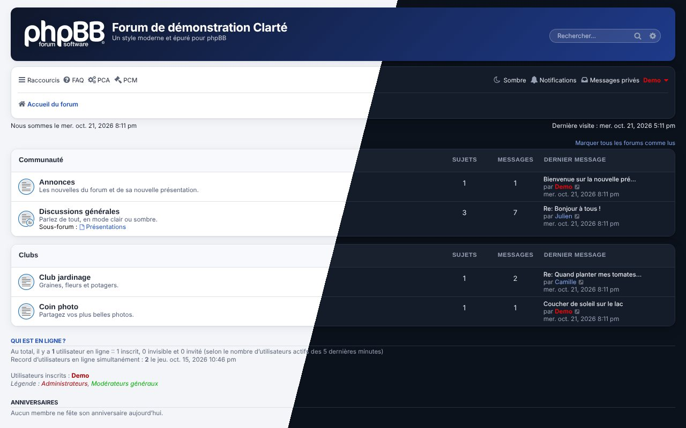

| Sujet, mode clair | Sujet, mode sombre |
|---|---|
| 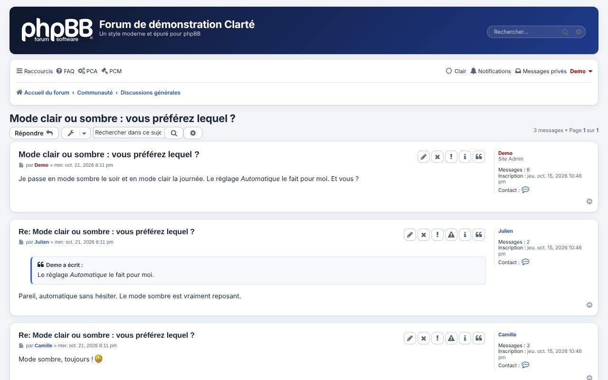 | 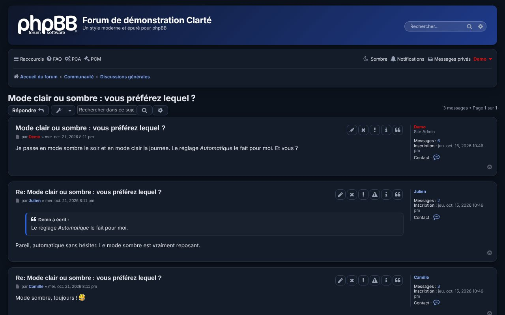 |
| **Un forum coloré par un modèle** | **Mobile, barre en icônes seules** |
| 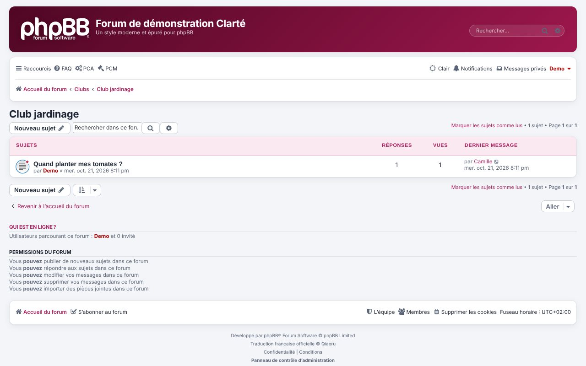 | 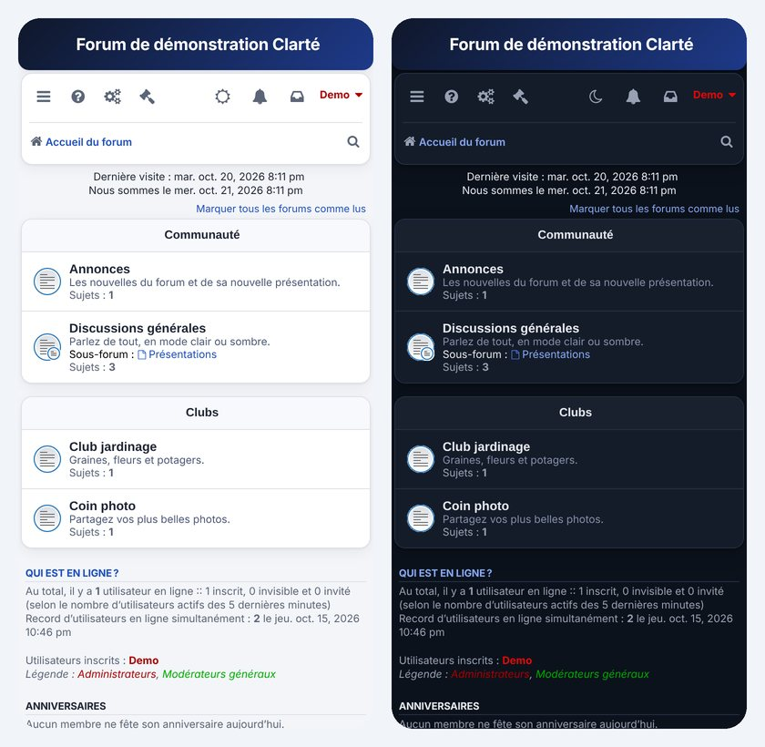 |

## Fonctions

- **Mode clair, sombre ou automatique** sur tout le forum, avec un bouton *Apparence* dans la barre de navigation (choix retenu par le navigateur, invités compris), sans clignement au chargement.
- **Couleurs réglables dans l'ACP** : palettes prêtes ou couleurs libres, couleur principale, en-tête en dégradé, bandeau des catégories, police, arrondi, aperçu clair / sombre en direct.
- **Modèles enregistrés** : garder un ensemble de couleurs sous un nom, l'appliquer, le modifier, le dupliquer, l'exporter ou l'importer (.json).
- **Couleurs par forum** : un modèle pour un forum ou une catégorie, hérité par les sous-forums.
- **Styles au choix** : un modèle devient un style « Clarté – nom » que les membres choisissent dans leur panneau ; retiré en un clic, ses membres reviennent à Clarté.
- **Sauvegarde et restauration** de tous les réglages, modèles, couleurs par forum et styles au choix.
- **Toute l'ACP aux couleurs de Clarté**, pages des extensions comprises (désactivable).
- **Mobile** : barre de navigation compacte en icônes seules ; **date de l'accueil** masquable ; couleurs de groupes lisibles en mode sombre.
- Aucune table ajoutée, aucun fichier de phpBB modifié ; langues : français, anglais.

## Téléchargement

Chaque version publiée (onglet [Releases](https://github.com/verturin/clarte/releases)) propose trois paquets :

| Paquet | Contenu | Pour qui |
|---|---|---|
| `clarte - v X.Y.Z.zip` | `styles/clarte/` + `ext/verturin/clarte/` | **à utiliser en général** : tout Clarté, à déposer à la racine du forum |
| `clarte-style - v X.Y.Z.zip` | `clarte/` | le style seul (à déposer dans `styles/`) |
| `clarte-extension - v X.Y.Z.zip` | `verturin/clarte/` | l'extension seule (à déposer dans `ext/`) |

Le style fonctionne seul (bleu, mode automatique) ; l'extension apporte tous les réglages ci-dessous.

## Contenu

| Dossier | Rôle |
|---|---|
| `styles/clarte/` | Le style lui-même, enfant de prosilver. Il fonctionne seul (mode automatique, couleur bleue). |
| `ext/verturin/clarte/` | L'extension « Clarté — réglages du style » : pages de réglages, bouton « Apparence », modèles, couleurs par forum, styles au choix, sauvegarde, habillage de toute l'administration. |
| `docs/` | Captures du README. |
| `tools/` | Outils de génération des couleurs (après une mise à jour de phpBB ou de Portfolio). |
| `dev/` | Scripts de développement et de test (forum de test local) ; ne font pas partie du style. |

Comme Clarté est un style enfant, prosilver doit rester installé (il l'est toujours, c'est le style d'origine de phpBB). Les mises à jour de phpBB qui corrigent prosilver profitent aussi à Clarté.

## Installation

1. Décompressez `clarte - v 1.4.1.zip` et envoyez les dossiers `styles` et `ext` à la racine du forum (là où se trouvent `index.php` et `config.php`). Les dossiers se fusionnent avec ceux qui existent.
2. ACP › **Personnaliser** › **Gérer les extensions** : activez **Clarté — réglages du style**.
3. ACP › **Personnaliser** › **Styles** › *Installer des styles* : installez **Clarté**.
4. Pour en faire le style de tout le forum : ACP › **Général** › *Paramètres du forum* › **Style par défaut** = Clarté. Vérifiez aussi que le *Style du forum* de chaque forum (ACP › Forums › Gérer les forums) est sur *Style par défaut*.
5. ACP › **Extensions** › **Style Clarté** › *Couleurs et apparence* : choisissez vos couleurs.

## Mise à jour

Envoyez les dossiers `styles` et `ext` du nouveau zip par-dessus les anciens, puis, dans ACP › Personnaliser › Gérer les extensions, désactivez puis réactivez **Clarté — réglages du style** (les nouvelles options sont ajoutées, vos couleurs et modèles sont conservés). Purgez enfin le cache depuis l'accueil de l'ACP. Le journal des versions ci-dessous précise quand la désactivation n'est pas nécessaire.

## Réglages dans l'ACP

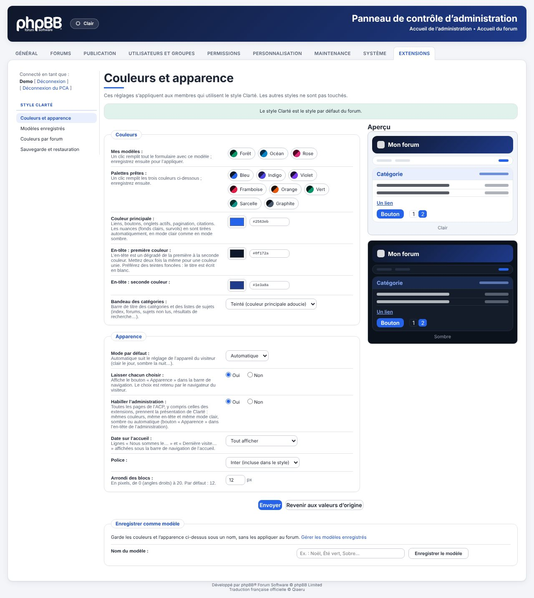

- **Palettes prêtes** : bleu, indigo, violet, framboise, orange, vert, sarcelle, graphite. Un clic remplit les trois couleurs.
- **Mes modèles** : vos modèles enregistrés, en un clic dans le formulaire.
- **Couleur principale** : liens, boutons, onglets actifs, pagination, citations. Toutes les nuances (fonds clairs, survols, couleurs de prosilver) en sont tirées, en mode clair comme en mode sombre.
- **En-tête** : dégradé de deux couleurs (mettez deux fois la même pour un aplat).
- **Bandeau des catégories** : barre de titre des catégories et des listes de sujets — neutre, teinté (couleur principale adoucie), comme l'en-tête ou couleur choisie (texte blanc ou foncé selon la couleur).
- **Mode par défaut** : automatique (suit l'appareil du visiteur), clair ou sombre.
- **Laisser chacun choisir** : affiche le bouton *Apparence* dans la barre de navigation (Automatique → Clair → Sombre). Le choix est retenu par le navigateur, y compris pour les invités.
- **Habiller l'administration** : applique Clarté à toutes les pages de l'ACP (voir plus bas).
- **Date sur l'accueil** : afficher ou masquer « Nous sommes le… » et « Dernière visite… » sur l'accueil.
- **Police** : Inter (incluse, aucun appel extérieur) ou celle de l'appareil.
- **Arrondi des blocs** : de 0 à 20 px.
- Un **aperçu** clair et sombre se met à jour pendant la saisie. Le bouton *Revenir aux valeurs d'origine* remet tout à zéro. En bas de page, **Enregistrer comme modèle** garde les valeurs du formulaire sous un nom, sans les appliquer.

## Modèles enregistrés et styles au choix

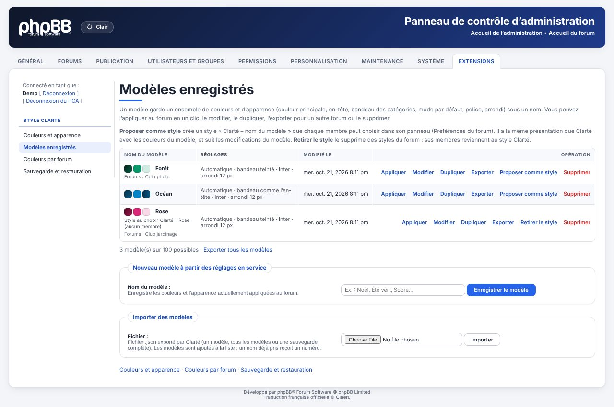

- **Modèles enregistrés** (ACP › Extensions › Style Clarté) : appliquer, modifier, dupliquer, exporter, importer, supprimer. Un modèle contient la couleur principale, l'en-tête, le bandeau des catégories, le mode par défaut, la police et l'arrondi ; les options propres au forum (bouton *Apparence*, habillage de l'ACP, date sur l'accueil) n'en font pas partie et ne changent pas quand on applique un modèle.
- **Styles au choix** : *Proposer comme style* crée un style enfant de Clarté, `styles/clarte_m<n>/`, avec quelques fichiers relais ; les couleurs sont lues dans le modèle à chaque page. Les membres le choisissent dans *Préférences du forum › Mon style* (option *Remplacer le style des membres* désactivée). *Retirer le style* (ou supprimer le modèle) l'efface et renvoie ses membres vers Clarté. La liste indique le nombre de membres de chaque style et les forums colorés par chaque modèle.

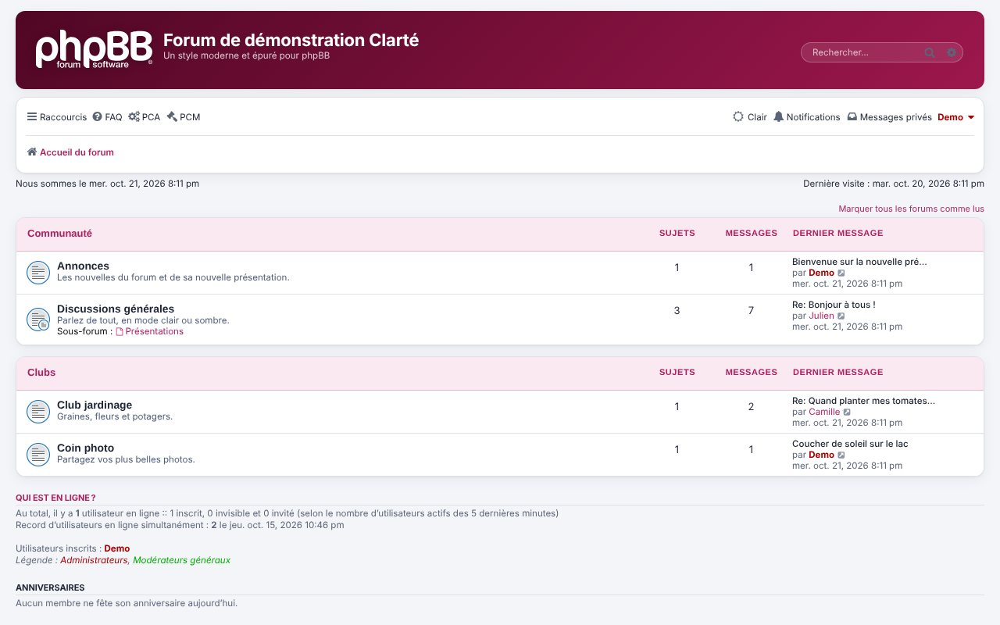

## Couleurs par forum

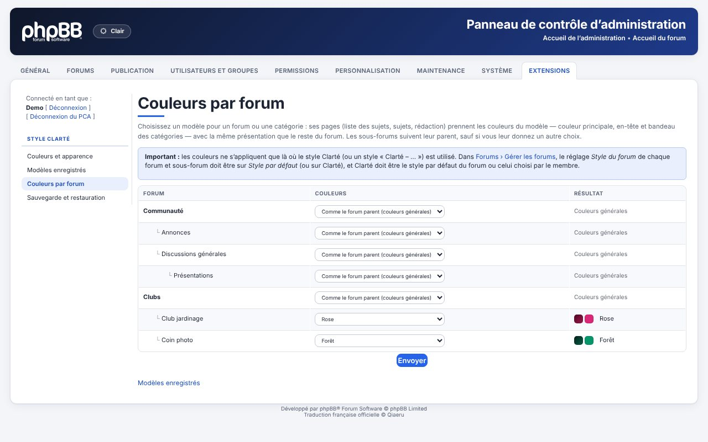

- Pour chaque forum ou catégorie (ACP › Extensions › Style Clarté › *Couleurs par forum*), choisissez un modèle, *Comme le forum parent* (par défaut) ou *Couleurs générales*. Seules les couleurs changent (couleur principale, en-tête, bandeau des catégories) : police, arrondi et mode restent ceux du forum. Les couleurs du forum passent avant celles du style choisi par le membre.
- **Important** : Clarté doit être le style utilisé partout où les couleurs doivent s'appliquer. Dans ACP › Forums › Gérer les forums, le réglage *Style du forum* de chaque forum et sous-forum doit être sur *Style par défaut* (ou Clarté), et Clarté doit être le style par défaut du forum (ou celui choisi par le membre). Un forum qui impose un autre style (prosilver ou autre) garde les couleurs de ce style ; la page *Couleurs par forum* le signale.

## Sauvegarde et restauration

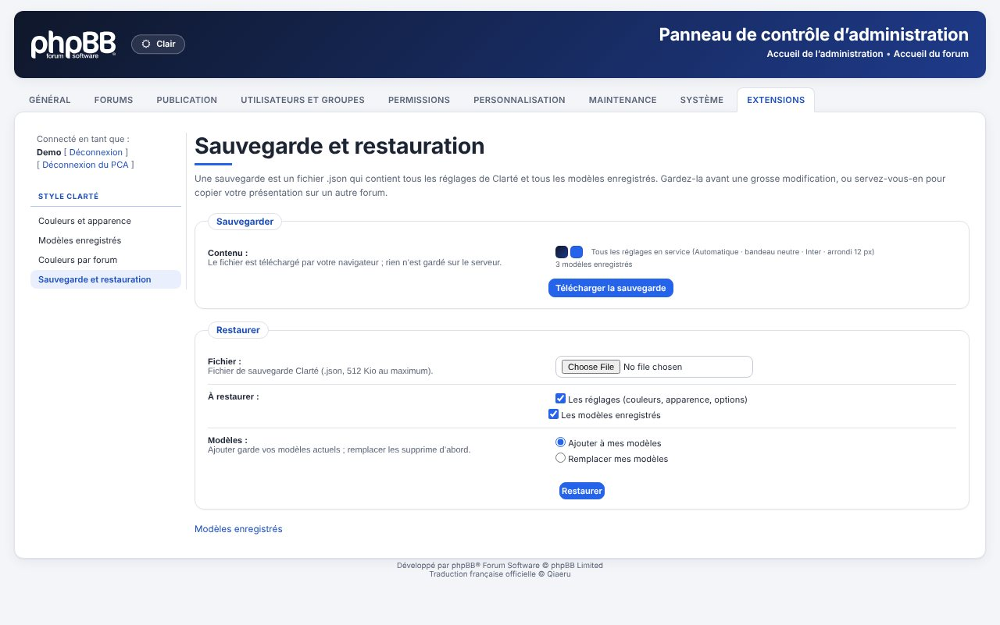

Un fichier `clarte-sauvegarde-AAAA-MM-JJ-hhmmss.json` contient tous les réglages, tous les modèles, les couleurs par forum et les styles au choix. À la restauration, vous choisissez quoi rétablir (réglages, modèles ajoutés ou remplacés). Il sert aussi à copier sa présentation sur un autre forum.

## L'administration aux couleurs de Clarté

| Paramètres du forum, mode sombre | Permissions avancées, mode sombre |
|---|---|
| 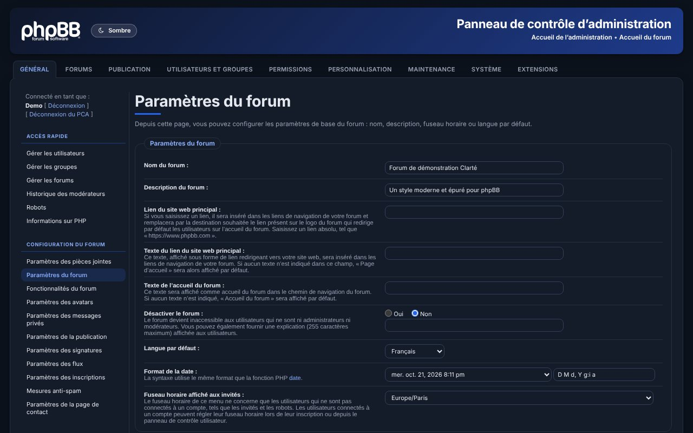 | 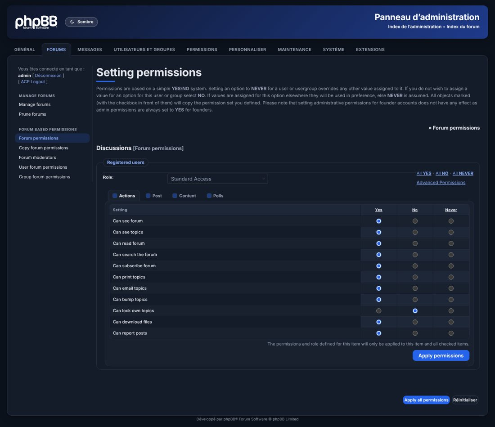 |
| **Portfolio, mode sombre** | **Réglages de Portfolio, mode sombre** |
| 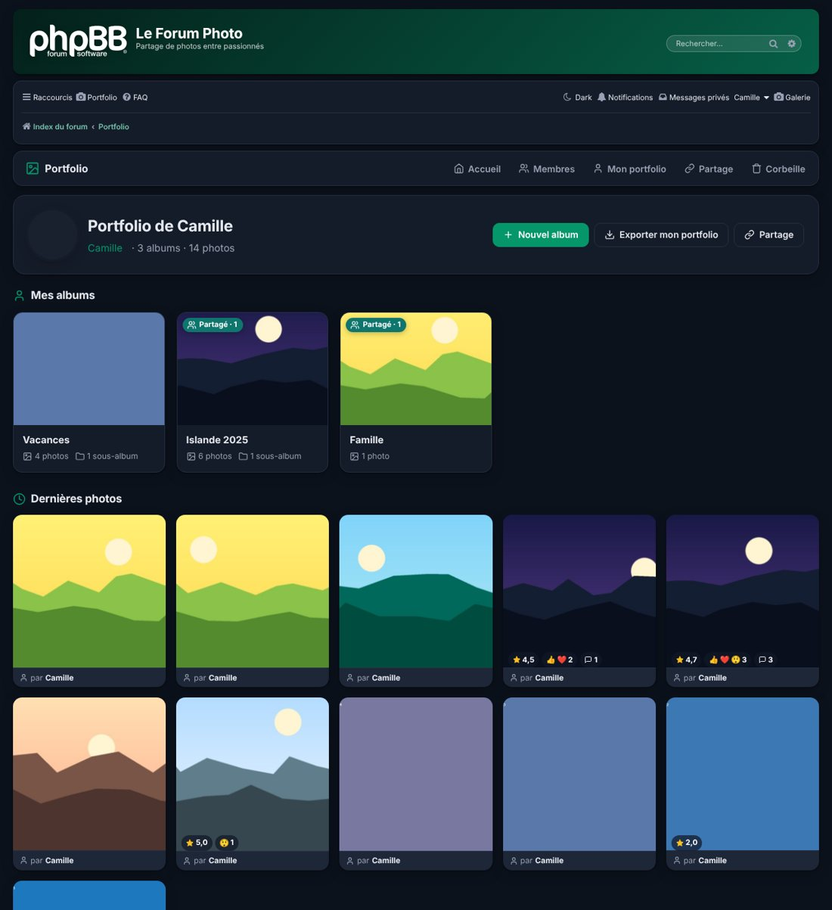 | 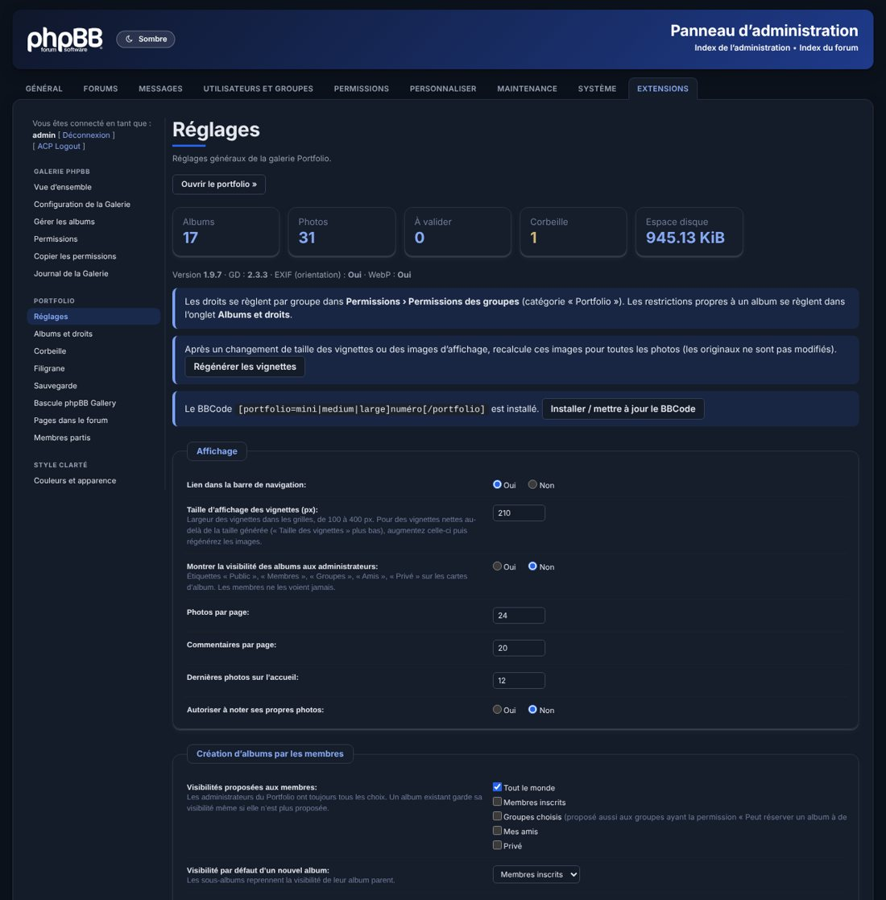 |

- **Toutes les pages de l'ACP** : accueil, paramètres, forums, membres et groupes, permissions (y compris la grille avancée), styles, extensions, journaux, maintenance… et les pages des extensions (Portfolio, phpBB Gallery, etc.).
- **Même charte que le forum** : en-tête en dégradé avec le logo phpBB en blanc, onglets, menu de gauche avec un trait sous chaque section, groupes de réglages en cartes arrondies, champs et boutons modernes, tableaux aérés.
- **Même couleur principale et même mode** que le forum. Un bouton *Apparence* dans l'en-tête de l'ACP passe d'Automatique à Clair puis à Sombre ; le choix est partagé avec le forum (même navigateur).
- L'option **Habiller l'administration** (Oui par défaut) permet de revenir à l'ACP d'origine de phpBB sans désactiver l'extension.

## Points techniques

- Toutes les couleurs de prosilver sont converties en variables CSS (`tools/tokenize_colours.py`), chacune avec sa valeur claire et sombre. Le mode sombre couvre donc l'ensemble du forum : index, sujets, rédaction, panneau de l'utilisateur, MCP, recherche, membres, messages privés.
- Le mode choisi est appliqué dans l'en-tête, avant l'affichage : pas de clignement blanc au chargement.
- Les couleurs saisies sont vérifiées (format `#rrggbb` uniquement) avant d'être écrites dans la page.
- Les réglages ne s'appliquent qu'aux membres qui utilisent Clarté (ou un style enfant de Clarté). Les autres styles ne sont pas touchés.
- Les couleurs de groupes, écrites en dur par phpBB, sont éclaircies en mode sombre pour rester lisibles.
- Extension Portfolio : ses pages suivent la couleur principale, la police et le mode sombre de Clarté.
- Administration : les couleurs de `adm/style/admin.css` de phpBB (et de la feuille de l'ACP de Portfolio) sont converties de la même façon par `tools/tokenize_admin.py`, qui produit `adm/style/clarte_admin_colours.css` ; `clarte_admin.css` apporte le dessin. Les deux feuilles sont chargées après celles de phpBB et des extensions, par l'événement `acp_overall_header_stylesheets_after` : aucun fichier de phpBB n'est modifié.
- Pour régénérer après une mise à jour de phpBB : `python3 tools/tokenize_admin.py ext/verturin/clarte/adm/style/clarte_admin_colours.css <forum>/adm/style/admin.css <forum>/ext/verturin/portfolio/adm/style/portfolio_acp.css`.
- Compatible phpBB 3.3.15 et plus ; aucune table ajoutée (12 clés `clarte_*` dans la configuration ; modèles, couleurs par forum et styles au choix en JSON dans `config_text` : `clarte_models`, `clarte_forum_models`, `clarte_model_styles`).

## Désinstallation

Choisissez un autre style par défaut, désinstallez Clarté dans *Styles*, puis désactivez et supprimez les données de l'extension. Supprimez enfin `styles/clarte` et `ext/verturin/clarte`.

## Crédits

- Police **Inter** © The Inter Project Authors, licence SIL Open Font License 1.1 (`styles/clarte/theme/fonts/OFL.txt`).
- Mise en page de **prosilver** © phpBB Limited.
- Clarté © 2026 verturin — GPL-2.0.

## Historique des versions

### 1.4.1 — 21 octobre 2026
- README refait avec de nouvelles captures (forum de démonstration), version anglaise `README.en.md`, section *Téléchargement* (paquet complet, style seul, extension seule).
- Page *Couleurs par forum* : rappel que les couleurs ne s'appliquent que là où Clarté (ou un style « Clarté – … ») est utilisé — le *Style du forum* de chaque forum et sous-forum doit être sur *Style par défaut* (ou Clarté). Les forums qui imposent un autre style sont signalés, avec un lien vers *Forums › Gérer les forums*.

### 1.4.0 — 20 octobre 2026
- **Couleurs par forum** (nouvelle page ACP › Extensions › Style Clarté › *Couleurs par forum*) : un modèle peut être choisi pour chaque forum ou catégorie. Ses pages (liste des sujets, sujets, rédaction) prennent les couleurs du modèle — couleur principale, en-tête, bandeau des catégories — avec la même présentation. Les sous-forums suivent leur parent, sauf s'ils ont leur propre choix ou *Couleurs générales*.
- **Modèles proposés comme styles** : sur la page *Modèles enregistrés*, *Proposer comme style* crée un style « Clarté – nom du modèle » que les membres choisissent dans leur panneau (Préférences du forum). Il suit les changements du modèle (couleurs et nom). *Retirer le style* le supprime des styles du forum : ses membres (et le style par défaut, s'il l'était) reviennent au style Clarté.
- La liste des modèles indique le style au choix (avec son nombre de membres) et les forums colorés par chaque modèle ; la suppression d'un modèle retire aussi son style et rend leurs couleurs aux forums concernés.
- Un style généré supprimé depuis ACP › Personnaliser › Styles est oublié par l'extension, qui efface son dossier.
- Sauvegarde et restauration : les forums de chaque modèle et ses styles au choix sont sauvegardés et rétablis.
- Désinstallation (suppression des données de l'extension) : les styles générés sont retirés, leurs membres reviennent au style Clarté.
- Mise à jour : désactivez puis réactivez l'extension (nouvelle page, clés `clarte_forum_models` et `clarte_model_styles`), puis purgez le cache. Le serveur doit pouvoir écrire dans le dossier `styles/` pour créer les styles au choix.

### 1.3.2 — 16 octobre 2026
- Mobile (700 px et moins) : la barre de navigation n'affiche plus que les icônes (liens de phpBB et des extensions, pseudo à côté de l'avatar), et tient sur une seule ligne. Le menu burger et le menu du profil gardent leurs textes ; les textes masqués restent lus par les lecteurs d'écran. Rien ne change sur ordinateur.

### 1.3.1 — 16 octobre 2026
- Correction : *Date sur l'accueil* ne masquait rien quand une extension place ces lignes dans un autre bloc de la page (bandeau, classement…). Les lignes sont maintenant visées où qu'elles soient sur l'accueil.

### 1.3.0 — 15 octobre 2026
- **Modèles enregistrés** : les couleurs et l'apparence (couleur principale, en-tête, bandeau des catégories, mode par défaut, police, arrondi) peuvent être gardées sous un nom, depuis la page de réglages (*Enregistrer comme modèle*) ou depuis la nouvelle page *Modèles enregistrés*. Les modèles apparaissent aussi en tête de la page de réglages (*Mes modèles*) : un clic remplit le formulaire.
- Nouvelle page **Modèles enregistrés** : appliquer (avec confirmation), modifier (nom et réglages, avec l'aperçu), dupliquer, exporter (un modèle ou tous, fichier .json), importer, supprimer (avec confirmation). Le modèle en service est signalé. Jusqu'à 100 modèles.
- Nouvelle page **Sauvegarde et restauration** : télécharge un fichier .json avec tous les réglages et tous les modèles ; restauration au choix des réglages et/ou des modèles (ajoutés aux modèles existants ou à leur place). Les fichiers envoyés sont vérifiés (format, taille, couleurs).
- Nouveau réglage **Date sur l'accueil** : afficher ou masquer les lignes « Nous sommes le… » et « Dernière visite… » de l'accueil (tout afficher, masquer l'une ou l'autre, tout masquer).
- Journal d'administration : enregistrement, application, suppression et import de modèles, sauvegarde téléchargée et restaurée.
- Mise à jour : désactivez puis réactivez l'extension (nouvelle clé `clarte_index_time`, modèles stockés dans `clarte_models`, deux nouvelles pages dans le module), puis purgez le cache.

### 1.2.0 — 12 octobre 2026
- Nouveau réglage *Bandeau des catégories* : couleur de la barre de titre des catégories et des listes de sujets (`.forabg` / `.forumbg` : index, forums, sujets non lus, recherche…). Quatre choix : *Neutre* (gris clair, comme avant), *Teinté* (couleur principale adoucie, suit le mode sombre), *Comme l'en-tête* (même dégradé) ou *Couleur choisie*. Avec une couleur choisie, le texte passe automatiquement en blanc ou en foncé pour rester lisible.
- L'aperçu de la page de réglages montre le bandeau.
- Mise à jour : désactivez puis réactivez l'extension (nouvelles clés `clarte_cat_mode` et `clarte_cat_colour`), puis purgez le cache.

### 1.1.2 — 12 octobre 2026
- ACP : un trait sépare à nouveau les sections du menu de gauche (sous chaque titre, à la couleur principale), et les titres de section prennent la couleur principale : les groupes de liens (Messages, Fichiers joints, Portfolio, pages des extensions…) se distinguent nettement, en clair comme en sombre.
- Correction : la page *Couleurs et apparence* refusait d'enregistrer (« Veuillez modifier la valeur pour correspondre au format demandé ») même avec des couleurs valides, et l'aperçu ne suivait pas la saisie du code couleur. Le moteur de gabarits de phpBB transformait le `{6}` du contrôle de format en simple `6`.
- Après la mise à jour, purgez le cache (onglet *Général*) pour que la nouvelle feuille de l'ACP soit chargée.

### 1.1.1 — 11 octobre 2026
- ACP : couleurs régénérées pour les nouveautés de Portfolio 1.9.8 (barre de modification en nombre des albums), lisibles en mode sombre.
- ACP en mode sombre : couleurs de groupes (pseudos des administrateurs, etc.) éclaircies, comme sur le forum.

### 1.1.0 — 11 octobre 2026
- Habillage de toute l'administration (ACP) : en-tête, onglets, menu, groupes de réglages, champs, boutons, tableaux, messages, pagination, grille des permissions ; pages des extensions comprises.
- Mode clair, sombre ou automatique dans l'ACP, avec un bouton *Apparence* dans l'en-tête (choix partagé avec le forum).
- Pages d'administration de Portfolio harmonisées (couleur principale de Clarté, mode sombre).
- Nouvelle option *Habiller l'administration* (Oui par défaut).
- Page de réglages de Clarté lisible en mode sombre (palettes, sélecteurs de couleur).

### 1.0.0 — 11 octobre 2026
- Première version : style enfant de prosilver, mode clair, sombre ou automatique, bouton *Apparence* pour les membres.
- Extension de réglages : couleur principale, couleurs de l'en-tête, palettes prêtes, mode par défaut, police, arrondi, aperçu en direct.
- Intégration de l'extension Portfolio (couleurs et mode sombre).
